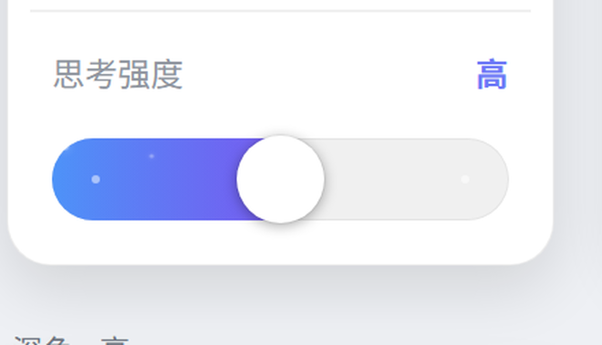

# WorkBuddy 思考强度滑条

把 WorkBuddy 模型菜单里的「思考强度」列表换成一条 **Codex 风格的连续滑条**。

> [!IMPORTANT]
> **2026-11-14：v3.0.0 复活，改用运行时注入。已在 Windows 版 WorkBuddy 5.9.3 上跑通。**
>
> 5.9.2 起客户端把 renderer 打进 `app.asar` 并加了 SHA256 完整性校验，老的
> 「往 `app.asar.unpacked/renderer/index.html` 插 loader」彻底没有落点。
>
> v3 不改客户端任何文件：快捷方式用客户端自带的 `node.exe` 跑一个注入器，
> 注入器带 `--inspect` 启动客户端、连上主进程、把 mod 脚本注入页面，
> 然后**立刻关掉调试端口**。

> **非官方项目**。与 WorkBuddy / 腾讯无任何关系。它通过运行时注入改动界面，
> 可能违反其服务条款，请自行判断是否使用。



## 它做了什么

官方菜单里，思考强度是「低 / 中 / 高 / 超高 / 极致」几项列表。这个项目把那些项**原地**换成一条滑条：

- 拖动 → 档位跟着变，档位名显示在标题右侧
- 颜色随强度从蓝到紫渐变，越往右星尘越密
- 滑条可以含「关」：拖到最左即关闭思考，和 Codex 一致

**写入仍然走官方路径**：你在滑条上松手时，它去点对应的官方档位项（或官方开关）。
所以档位状态、持久化、后端请求全是官方逻辑，不存在"自己维护一份状态"的问题。

## 安装（5.9.2 及以上）

1. 下载 Release 里的 zip，解压到任意目录
2. 双击 `install.cmd`
3. **托盘右键，完全退出 WorkBuddy**
4. 用你平时那个 WorkBuddy 图标启动（桌面 / 开始菜单 / 任务栏都行）
5. 点开模型菜单 → 悬停某个模型 → 悬停「思考强度」

> [!NOTE]
> 安装器会**接管**桌面、开始菜单、任务栏固定项里的 `WorkBuddy.lnk`：
> 原文件备份成 `WorkBuddy.lnk.wbmods.bak`，快捷方式的名字和图标不变，
> 只是背后多跑一个注入器。所以不用记新图标。
>
> 不想被接管就加 `-KeepOfficialIcon`，那样只能从新出现的
> 「WorkBuddy (mods)」启动。

`install.cmd -Status` 看状态，`uninstall.cmd` 一键还原（会把官方图标也还原）。启动时可能闪过一个最小化的窗口，那是注入器。

## 设置

右键滑条：

| 项 | 说明 |
|---|---|
| 动画效果 | `简洁` = 跟手 + 星尘；`完整` = 跟手 + 扫光 + 星尘 |
| 刻度点 | 轨道上的小圆点：亮白 / 同色 / 隐藏 |
| 官方档位列表 | 保留官方那几个列表项（默认关闭） |
| 面板紫边 | 面板外圈紫光 |

## 工作原理

```
「WorkBuddy (mods)」快捷方式
  └─ node.exe injector.js
       ├─ 带 --inspect=<随机端口> 启动 WorkBuddy.exe
       ├─ 连上主进程 inspector
       ├─ 注入 bootstrap：挂 web-contents-created，dom-ready 时 executeJavaScript(mod.js)
       └─ 注入成功后从主进程里关掉 inspector（端口不留在外面）
```

注入器的三条硬约束：

1. 只在 `app.asar/renderer/index.html` 这个页面上注入，guest 页面一律跳过
2. spawn 客户端时清掉 `ELECTRON_RUN_AS_NODE`，确保它正常进入 GUI 模式
3. 注入完成 1.2 秒后关闭 inspector，不留下可执行代码的调试端口

## 兼容性

### 系统

| 环境 | 状态 |
|---|---|
| Windows 11 x64 | ✅ 已验证（5.9.3） |
| Windows 10 x64 | ✅ 支持，只用 PowerShell 5.1 内置能力，不需要装任何东西 |
| 32 位系统 | ❌ 客户端本身没有 32 位版本 |
| macOS / Linux | ❌ 客户端只有 Windows 版 |

管理员安装（装在 `Program Files`）也能用：安装器把文件写到当前用户的
`%LOCALAPPDATA%`，不需要管理员权限。公共桌面那个快捷方式没有权限时会跳过，
不影响其它图标。

### 安装目录

**任意盘、任意路径、含中文或空格都行**，不要求叫 `WorkBuddy`。

安装器不猜目录名，它按六条独立线索找，只要目录里存在 `resources\app.asar`
就认——这是客户端独有的特征文件：

| 顺序 | 线索 | 说明 |
|---|---|---|
| 1 | `config.json` | 上次装成功时记下的路径，最快的路径 |
| 2 | 运行中的进程 | `Get-Process WorkBuddy` 的 `Path` |
| 3 | 注册表卸载项 | `DisplayIcon` / `InstallLocation` / `UninstallString`。**安装器常常只填 DisplayIcon**，所以只读 `InstallLocation` 会漏 |
| 4 | App Paths | `HKLM` / `HKCU` 两处，含 WOW6432Node |
| 5 | 快捷方式 | 桌面、公共桌面、开始菜单（递归）、任务栏固定项。**按目标或图标指向 `WorkBuddy.exe` 判定**，不靠文件名 |
| 6 | 默认路径 | `%LOCALAPPDATA%\Programs`、`Program Files`、`Program Files (x86)` |

全部落空时会明确报错，并给出 `install.cmd -AppRoot "D:\你的\WorkBuddy"` 的手动指定方式。

### 客户端被移动 / 重装到别处

- **快捷方式不会失效**：它指向 `%LOCALAPPDATA%\WbMods\node.exe`，这是一个指向
  客户端自带运行时的硬链接（NTFS 下不额外占空间）。实测**删除源文件后硬链接仍可执行**，
  所以客户端升级换掉 `versions\<版本号>\` 目录，图标照样能打开。
- **注入器会自愈**：`config.json` 里存了安装时探测到的全部候选路径，
  `app` 失效时按候选逐个试。实测把 `app` 改成不存在的盘符，仍能从候选找回。

### 客户端版本与 DOM

- v2.x 对应 5.8.3，v3 对应 **5.9.2 / 5.9.3**（已在 5.9.3 实测）
- 依赖官方 DOM 类名（`.cr-model-selector__sub-panel*`、`__item--active`），官方改版可能失效
- 面板识别用结构锚点（思考模式开关 + 档位文案），语言无关；5.9.2 新增的「自定义模型」入口若带独立档位面板，滑条可能不出现
- 失效表现：滑条不出现，官方列表照常工作（fail-open）

> [!WARNING]
> 唯一的硬性前提：**包管理器装、绿色解压版**这类没有注册表项、没有开始菜单快捷方式、
> 也没有自带 node 运行时的分发形式，自动识别会落空。这种情况用 `-AppRoot` 指定一次即可。

## 排查

日志：`%LOCALAPPDATA%\WbMods\loader.log`

```
injector spawn app with --inspect=1999
main bootstrap ok, mods=2
injector evaluate => OK:2
main injected effort-slider@3.0.0
main inspector closed
```

| 现象 | 原因 |
|---|---|
| 日志没有新增 | 快捷方式没被接管（装的时候用了 `-KeepOfficialIcon`，或系统重建过图标）→ 重跑一次 `install.cmd` |
| 有 `spawn app` 没有 `bootstrap ok` | 客户端已经在跑（单实例锁），先完全退出 |
| 有 `bootstrap ok` 没有 `injected` | 页面 URL 不匹配，客户端改版了 |
| 日志里 `app exe not found` | 客户端被移动过，候选也全失效了 → 重跑 `install.cmd` 刷新路径 |

想确认注入器能不能找到客户端、有没有读到 mod，不必启动客户端，用 dry-run：

```powershell
$env:WB_DRY_RUN=1
& "$env:LOCALAPPDATA\WbMods\node.exe" "$env:LOCALAPPDATA\WbMods\injector.js"
```

日志里会多一行 `dry-run app=<实际用到的客户端路径> mods=[...]`。
装好后如果这行没有，说明是快捷方式的问题，不是注入的问题。

> 任务栏固定项如果点了还是原版：右键取消固定，再从开始菜单把 WorkBuddy 固定回去
> （开始菜单那个已经被接管了）。Windows 有时会缓存旧的固定项。

## 安全边界

- **不联网**、不读对话内容、不采集数据，只操作模型菜单 DOM
- **不修改客户端任何文件**：所有东西都在 `%LOCALAPPDATA%\WbMods`
- 会改写桌面 / 开始菜单 / 任务栏的 `WorkBuddy.lnk`，原文件备份为 `.wbmods.bak`；
  `uninstall.cmd` 会原样还原
- 调试端口只在启动后存在约 1 秒，注入完成即关闭
- **fail-open**：注入失败时客户端照常启动，只是没有滑条

## 和「模型图标」共存

两个 mod 共用同一个注入器和快捷方式，各自在 `mods/<id>/` 下独立安装。
先装哪个都行，卸载任意一个不影响另一个。

## 版本与提交记录

每个版本做了什么、为什么这么改，写在 [CHANGELOG.md](CHANGELOG.md) 里。

## License

MIT
