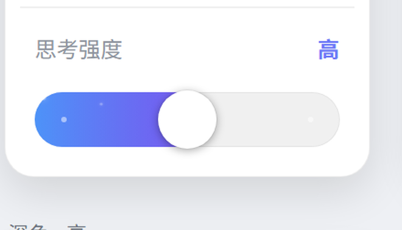

# WorkBuddy 思考强度滑条

把 WorkBuddy 模型菜单里的「思考强度」列表换成一条 **Codex 风格的连续滑条**。

> **非官方项目**。与 WorkBuddy / 腾讯无任何关系。它通过修改客户端的一个入口文件来注入脚本，
> 可能违反其服务条款，请自行判断是否使用。



## 它做了什么

官方菜单里，思考强度是「低 / 高 / 极致」三项列表。这个项目把那三项**原地**换成一条滑条：

- 拖动 → 档位跟着变，档位名显示在标题右侧
- 颜色随强度从蓝到紫渐变，越往右星尘越密
- 滑条**不含「关」**：关思考请用上面的「思考模式」开关（和 Codex 一致）

**写入仍然走官方路径**：你在滑条上松手时，它去点对应的官方档位项。
所以档位状态、持久化、后端请求全是官方逻辑，不存在"自己维护一份状态"的问题。

## 安装

1. 下载 Release 里的 zip，解压到任意目录
2. 双击 `install.cmd`
3. **完全退出 WorkBuddy 再打开**（托盘图标右键退出，只关窗口不够）
4. 点输入框的模型按钮 → 悬停某个模型 → 悬停「思考强度」

安装器只做三件事：

```
备份 index.html  ->  从备份生成一份带加载器的入口（体积必须 ≤ 原文件）  ->  复制脚本
```

`install.cmd -Status` 看状态，`install.cmd -Uninstall` 一键还原。

## 设置

右键滑条：

| 项 | 说明 |
|---|---|
| 动画效果 | `简洁` = 跟手 + 星尘；`完整` = 跟手 + 扫光 + 星尘 |
| 刻度点 | 轨道上的小圆点：亮白 / 同色 / 隐藏 |
| 官方档位列表 | 保留官方那三个列表项（默认关闭） |
| 面板紫边 | 面板外圈紫光 |

## 兼容性

- 只测过 **Windows 版 WorkBuddy 5.8.3**（`resources/app.asar` 里 `renderer/index.html` 标记 `unpacked: true`）
- 依赖官方 DOM 类名（`.cr-model-selector__sub-panel*`），**官方改版可能失效**
- 失效表现：滑条不出现，官方列表照常工作（fail-open，不会弄坏菜单）

## 关于「安全」

说清楚边界：

- 脚本**不联网**、不读取任何对话内容、不采集任何数据，只操作模型菜单里的 DOM
- 不改可执行文件、不碰 `app.asar` 本体，只改一个 **HTML 入口**并新增一个 js 文件
- 但有两点必须承认：
  1. 修改客户端文件本身有风险，官方可能校验文件完整性
  2. 客户端更新会覆盖入口文件，需要重装（`install.cmd` 再跑一次即可）

## 工作原理

1. `index.html` 里插一段加载器，按 `location` 推出 `resources/` 路径，加载 `wb-effort-slider.js`
2. 脚本找到模型菜单里的思考强度面板，把档位项隐藏、原位插入滑条
3. 拖动时只更新 UI；松手后点一次官方档位项，让官方自己完成写入

> 踩过的坑：Electron 会按 asar 头里记录的 `size` 返回入口文件内容，**超出的字节会被截断**。
> 所以入口文件必须保持在原始字节数以内——安装器会删掉 HTML 注释和空行来腾空间。

## 同类项目

同一思路在 **DSH（DeepSeek Harness）** 生态里已有几个实现：

- [HanaAyane/dsh-reasoning-effort](https://github.com/HanaAyane/dsh-reasoning-effort) ★235
- [Microqian2th/dsh-codex-effort-slider](https://github.com/Microqian2th/dsh-codex-effort-slider) ★168
- [bakabaicai/DSH-Codex-reasoning-effort-slider](https://github.com/bakabaicai/DSH-Codex-reasoning-effort-slider)

它们都是插件形态（DSH 有 UI 扩展点）；WorkBuddy 目前的插件体系只有 SKILL 和 MCP，
没有 UI 扩展点，所以这里只能用"注入入口文件"的方式。

## License

MIT
